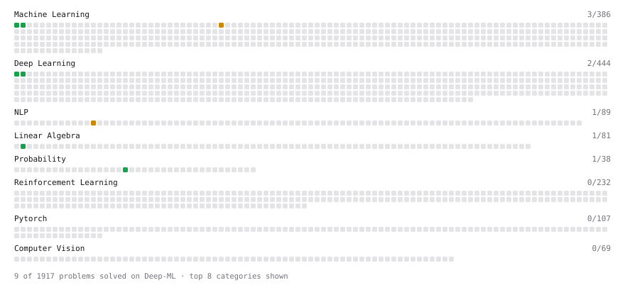

# Deep-ML

My machine learning practice from [Deep-ML](https://www.deep-ml.com). Every solution here was written by hand.

**12** solved · 12 problems · 0 labs · 0 math

[**Browse the interactive portfolio**](https://Albikro.github.io/deep-ml/) to replay this filling in over time.

## Problems

| | Difficulty | Solved | |
| --- | --- | --- | --- |
| [Binary Classification with Logistic Regression](https://www.deep-ml.com/problems/104) | easy | 2026-11-14 | [solution](problems/0104-binary-classification-with-logistic-regression) |
| [Linear Regression Using Gradient Descent](https://www.deep-ml.com/problems/15) | easy | 2026-10-31 | [solution](problems/0015-linear-regression-using-gradient-descent) |
| [Linear Regression Using Normal Equation](https://www.deep-ml.com/problems/14) | easy | 2026-10-31 | [solution](problems/0014-linear-regression-using-normal-equation) |
| [Recursive Least Squares for Simple Linear Regression](https://www.deep-ml.com/problems/1820) | easy | 2026-11-11 | [solution](problems/1820-recursive-least-squares-for-simple-linear-regression) |
| [Sigmoid Activation Function Understanding](https://www.deep-ml.com/problems/22) | easy | 2026-10-26 | [solution](problems/0022-sigmoid-activation-function-understanding) |
| [Simulate Two-Dice Sum Distribution](https://www.deep-ml.com/problems/1139) | easy | 2026-10-12 | [solution](problems/1139-simulate-two-dice-sum-distribution) |
| [Softmax Activation Function Implementation ](https://www.deep-ml.com/problems/23) | easy | 2026-10-26 | [solution](problems/0023-softmax-activation-function-implementation) |
| [Transpose of a Matrix](https://www.deep-ml.com/problems/2) | easy | 2026-11-01 | [solution](problems/0002-transpose-of-a-matrix) |
| [Byte Pair Encoding (BPE) Tokenizer](https://www.deep-ml.com/problems/380) | medium | 2026-10-26 | [solution](problems/0380-byte-pair-encoding-bpe-tokenizer) |
| [Chain Rule for Composite Functions](https://www.deep-ml.com/problems/214) | medium | 2026-10-12 | [solution](problems/0214-chain-rule-for-composite-functions) |
| [Linear Regression - Power Grid Optimization](https://www.deep-ml.com/problems/92) | medium | 2026-11-05 | [solution](problems/0092-linear-regression-power-grid-optimization) |
| [Logistic Regression by Iteratively Reweighted Least Squares](https://www.deep-ml.com/problems/1807) | medium | 2026-11-14 | [solution](problems/1807-logistic-regression-by-iteratively-reweighted-least-squares) |

---

_This file is regenerated by Deep-ML on every push._
